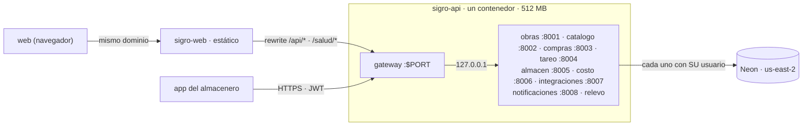

# Ambiente de pruebas (HT-01) · Render + Neon, gratis, en un solo nodo (ADR-10)

Para qué: que alguien distinto del autor pruebe cada HU en un lugar público (T8 de la DoD) y que la app del
emulador o del celular tenga a qué servidor conectarse. Responsable: Fernando. Lo puede ejecutar Claude Code.

**Cómo está armado (ADR-10).** En pruebas, los microservicios corren en **un solo servicio gratuito de Render,
`sigro-api`**: un contenedor (`api/Dockerfile.pruebas`) con **un proceso por microservicio**. El gateway atiende
`$PORT`; obras, catálogo, compras, tareo, almacén, costo e integraciones escuchan en `127.0.0.1:8001–8007`,
notificaciones en `8008`, y el relevo corre sin puerto. Un supervisor liviano (`infra/un_nodo/supervisor.py`)
reinicia el proceso que se cae. Cada servicio sigue con **su propio usuario y su propio esquema de base**: el
supervisor le pasa a cada proceso solo su cadena (`SIGRO_DB_OBRAS` → `SIGRO_APP_DATABASE_URL` de obras, etc.).
La web (`sigro-web`) es un sitio estático que llama a **su propio dominio**; Render reescribe `/api/*` y `/salud/*`
hacia `sigro-api`. **La arquitectura no cambia** (ADR-09): producción y `docker-compose.yml` siguen con un
contenedor por servicio. Diagramas: [`diagramas/despliegue-pruebas-un-nodo.png`](diagramas/despliegue-pruebas-un-nodo.png)
y [`diagramas/despliegue-produccion.png`](diagramas/despliegue-produccion.png).



## Lo que solo Fernando puede hacer (5 minutos)

1. **Neon** (https://neon.tech): proyecto `sigro`, región **AWS US East 2 (Ohio)** → copiar la *connection string*
   del dueño (`postgresql://...neon.tech/neondb?sslmode=require`).
2. **Render** (https://render.com): cuenta con GitHub y acceso al repositorio `xteban-sp/sevens-sigro`.
3. Pasarle a Claude Code la cadena de Neon **por variable de entorno**, nunca en un archivo del repositorio.

## Base: migrar, un usuario por servicio y datos reales

```bash
# 1) Migrar y crear un usuario por servicio en Neon (desde la carpeta del repo). Cadena DIRECTA (sin -pooler).
export SIGRO_DATABASE_URL="postgresql+psycopg://<dueño>@<host-neon>/neondb?sslmode=require"
export SIGRO_OWNER_DSN="postgresql://<dueño>@<host-neon>/neondb?sslmode=require"
export SIGRO_CLAVE_OBRAS=... SIGRO_CLAVE_CATALOGO=... SIGRO_CLAVE_COMPRAS=... SIGRO_CLAVE_TAREO=... SIGRO_CLAVE_ALMACEN=... SIGRO_CLAVE_COSTO=... SIGRO_CLAVE_RELEVO=...
cd api && sh ../infra/migrar.sh

# 2) Datos reales de prueba (HT-07), cada carga con el usuario de SU servicio, y primer administrador
SIGRO_APP_DATABASE_URL="postgresql+psycopg://sigro_compras:<clave>@<host>/neondb?sslmode=require" python -m semillas.cargar_proveedores semillas/proveedores-cliente.json
SIGRO_APP_DATABASE_URL="postgresql+psycopg://sigro_catalogo:<clave>@<host>/neondb?sslmode=require" python -m semillas.cargar_catalogo semillas/catalogo-cliente.json
SIGRO_APP_DATABASE_URL="postgresql+psycopg://sigro_obras:<clave>@<host>/neondb?sslmode=require" SIGRO_ADMIN_CLAVE='<clave>' \
    python -m app.cli primer-admin --usuario <usuario> --nombre "<nombre>" --obra "Multifamiliar Flores" --inicio 2026-10-19 --fin 2027-10-17
```

**Ojo con `migrar.sh`:** vuelve a fijar la contraseña de **todos** los usuarios con las `SIGRO_CLAVE_*` que reciba.
Si se corre otra vez, hay que pasarle las claves vigentes de cada uno; si no, cambian y hay que actualizar las
`SIGRO_DB_*` de `sigro-api`.

## Variables de `sigro-api`

| Variable | Valor | ¿Quién la pone? |
|---|---|---|
| `SIGRO_DB_OBRAS` … `SIGRO_DB_COSTO` (6) | `postgresql+psycopg://sigro_<servicio>:<su clave>@<host-neon-**pooler**>/neondb?sslmode=require` | **a mano** (`sync: false`) |
| `SIGRO_DB_RELEVO` | igual, con el usuario `sigro_relevo` | **a mano** (`sync: false`) |
| `FACTILIZA_TOKEN` | el token de Factiliza de Fernando | **a mano** (`sync: false`) |
| `SIGRO_JWT_SECRET`, `SIGRO_SERVICIO_TOKEN` | generados por Render | `render.yaml` (`generateValue`) |
| `SIGRO_ENTORNO`, `SIGRO_CORS`, `SIGRO_UN_NODO_EXTRAS`, pool, `SIGRO_SERVER_TIMING` | fijos | `render.yaml` |

Las `SIGRO_URL_*` **ya no se configuran**: el supervisor fija `http://127.0.0.1:800x`. Integraciones recibe
`SIGRO_SERVICIO_TOKEN` como su `SERVICIO_TOKEN` (exige `X-Servicio-Token`, HT-08) sin paso extra.

## Comprobar

1. `https://sigro-api.onrender.com/salud` → `{"estado":"ok","servicio":"gateway"}`.
2. Log de arranque de `sigro-api`: `[supervisor] procesos: gateway, obras, … relevo`, **sin** «(sin base)», y una
   línea `sigro base: pooler=sí pool=2+3` por cada servicio con base.
3. `https://sigro-web.onrender.com/salud/servicios` → `200` y los siete servicios `"ok"` (prueba la reescritura).
4. Entrar a `https://sigro-web.onrender.com` y abrir el catálogo y los proveedores.
5. Desde una máquina con Python: `SIGRO_BASE=https://sigro-api.onrender.com SIGRO_ADMIN_USUARIO=<usuario>
   SIGRO_ADMIN_CLAVE=<clave> python infra/un_nodo/humo.py` (crea un almacenero de prueba con su celular, registra
   un ingreso y una salida y comprueba el reenvío idempotente; no imprime claves).

## La app contra el ambiente

En la pantalla de entrada, «Servidor» → **`https://sigro-api.onrender.com`** (antes `sigro-gateway`). La primera
vez del día tarda lo que Render en despertar **un** servicio (antes despertaba ocho, uno por uno).

## Pasar a un nodo (desde los 8 servicios Docker) sin perder variables

Se hace una sola vez, cuando nadie esté probando; avisar al equipo y al Product Owner. **Nada se borra hasta el
paso 9.** Render nunca borra un servicio porque desaparezca de `render.yaml` («Changes to a Blueprint never cause
a resource to be deleted»), y las variables `sync: false` de un servicio **nuevo** en un Blueprint existente no se
piden: Render las ignora y hay que pegarlas a mano en el panel.

1. **Respaldar, fuera del repositorio** (un archivo local cifrado o el gestor de contraseñas del equipo). En cada
   servicio → *Environment* → copiar:

   | De | Variable | Pasa a `sigro-api` como |
   |---|---|---|
   | `sigro-obras` | `SIGRO_APP_DATABASE_URL` | `SIGRO_DB_OBRAS` |
   | `sigro-catalogo` | `SIGRO_APP_DATABASE_URL` | `SIGRO_DB_CATALOGO` |
   | `sigro-compras` | `SIGRO_APP_DATABASE_URL` | `SIGRO_DB_COMPRAS` |
   | `sigro-tareo` | `SIGRO_APP_DATABASE_URL` | `SIGRO_DB_TAREO` |
   | `sigro-almacen` | `SIGRO_APP_DATABASE_URL` | `SIGRO_DB_ALMACEN` |
   | `sigro-costo` | `SIGRO_APP_DATABASE_URL` | `SIGRO_DB_COSTO` |
   | `sigro-integraciones` | `FACTILIZA_TOKEN` | `FACTILIZA_TOKEN` |
   | grupo `sigro-comun` | `SIGRO_JWT_SECRET` (opcional) | `SIGRO_JWT_SECRET`, solo si se quiere que las sesiones abiertas sigan valiendo |
   | cualquier servicio | toda variable agregada a mano que **no** esté en la tabla de arriba | revisarla con el equipo antes de seguir |

   Revisar que las seis cadenas usen el host **`-pooler`** y que cada una tenga **su** usuario (`sigro_obras`,
   `sigro_catalogo`…): si dos servicios comparten usuario, corregirlo ahora. **`SIGRO_DB_RELEVO` no existe todavía**
   (el relevo nunca se desplegó): su clave es la `SIGRO_CLAVE_RELEVO` con que se corrió `migrar.sh`. Si nadie la
   tiene, el dueño la cambia en el *SQL Editor* de Neon: `ALTER ROLE sigro_relevo PASSWORD '<nueva>';` (solo ese
   usuario; no volver a correr `migrar.sh` sin todas las claves).
2. **Apagar el auto-sync** del Blueprint: Blueprint → *Settings* → *Auto Sync* → **No**. Así la fusión del PR no
   cambia nada sola.
3. **Fusionar el PR** (aprobado por alguien distinto del autor).
4. **Sincronizar** el Blueprint a mano (*Manual Sync*). Render **crea** `sigro-api` en Ohio y **actualiza**
   `sigro-web` (nueva `VITE_API_URL` y reescrituras). Los ocho servicios viejos y el grupo `sigro-comun` quedan como
   están, ya fuera del Blueprint. Si el nombre `sigro-api` estuviera tomado y Render le pusiera un sufijo, corregir
   el `destination` de las dos reescrituras de `sigro-web` en `render.yaml` (PR aparte).
5. **Pegar las variables** en `sigro-api` → *Environment*: las seis `SIGRO_DB_*` del paso 1, `SIGRO_DB_RELEVO` y
   `FACTILIZA_TOKEN` (y `SIGRO_JWT_SECRET` si se decidió conservarlo). *Save, rebuild and deploy*.
6. **Comprobar** con la lista de «Comprobar», arriba. Mientras falte una `SIGRO_DB_*`, ese servicio no arranca y
   `/salud/servicios` lo muestra «no_responde»; el resto funciona.
7. **Probar la reescritura** con un POST real: entrar desde `https://sigro-web.onrender.com` (el login es un POST con
   cuerpo). Si el login falla por la reescritura (405, 404 o el `Authorization` no llega), en `sigro-web` →
   *Environment* poner `VITE_API_URL=https://sigro-api.onrender.com`, redesplegar la web y anotarlo en el PR: la API
   ya acepta ese origen (`SIGRO_CORS`). Render documenta que el destino puede ser una URL pública completa, pero no
   dice qué métodos ni cabeceras reenvía: por eso se prueba aquí.
8. **App y equipo**: la app apunta a `https://sigro-api.onrender.com` (nuevo APK si la URL va fija). Volver a
   encender el *Auto Sync*. Dejar los ocho servicios viejos **suspendidos** (*Settings* → *Suspend*), no borrados,
   al menos un día de uso normal.
9. **Borrar los ocho servicios viejos** solo cuando: el paso 6 está todo en verde, alguien distinto de Fernando
   probó una HU de punta a punta en `sigro-api`, y el respaldo del paso 1 está guardado. Servicio → *Settings* →
   *Delete Web Service*: `sigro-gateway`, `sigro-obras`, `sigro-catalogo`, `sigro-compras`, `sigro-tareo`,
   `sigro-almacen`, `sigro-costo`, `sigro-integraciones`. Al final, el grupo `sigro-comun` (ya no lo usa nadie).
   **No** borrar `sigro-web` ni nada de Neon.

## Límites conocidos del plan gratuito

- `sigro-api` se duerme a los 15 min sin tráfico y Render tarda del orden de un minuto en despertarlo; ahora es
  **un** despertar para todo el sistema. La pantalla de arranque de la web lo espera (consulta cada 10 s; el
  gateway guarda la salud 30 s).
- **Memoria: 512 MB** para todos los procesos. Caben gracias a que el supervisor carga una vez las bibliotecas y crea
  cada servicio con `fork()` (CI: 366 MiB de 512, ADR-10 «Memoria»). Si el log muestra
  `terminó con código -9` o `137` (el sistema mató un proceso por memoria), poner `SIGRO_UN_NODO_EXTRAS=0`: se
  quitan relevo y notificaciones y los avisos y hechos de costo esperan en `outbox.evento` sin perderse.
- **0,1 CPU** compartida entre todos: una importación del S10 (PDF) hace más lentas las demás peticiones mientras dura.
- Sistema de archivos efímero: la base propia de notificaciones (`/tmp/notificaciones.db`, SQLite) **se pierde** al
  redesplegar o al dormirse `sigro-api`, y con ella la campana de cada usuario (`GET /api/v1/notificaciones` la lee
  de ahí). El evento original queda en `outbox.evento` (Neon) marcado como enviado: no se pierde el hecho, solo el
  aviso ya entregado. En producción notificaciones tiene su volumen (`docker-compose.yml`). Aceptable en pruebas.
