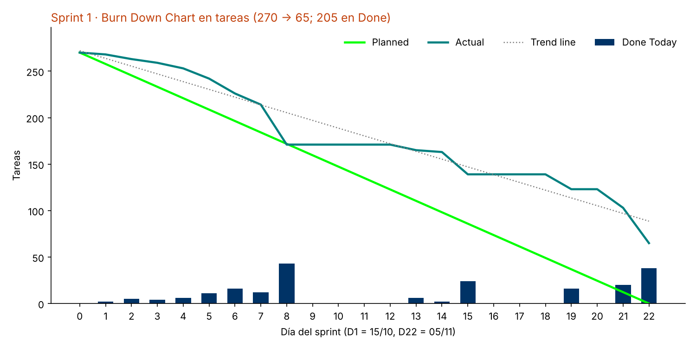
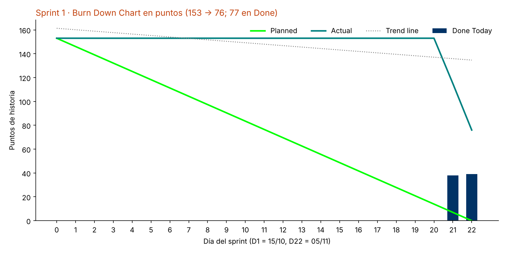

# Sprint 1 · 15/10 al 05/11/2026

**Resultado:** 16 de 29 HU en Done (77 de 153 puntos) · 205 de 270 tareas · 7 de 10 HT. Velocidad: 77.

- [Diseño por historia de usuario (PDF)](SIGRO%20-%20Sprint%201%20%C2%B7%20Dise%C3%B1o%20por%20historia%20de%20usuario.pdf): cada HU con su requisito, sus diagramas y su resultado.
- [Burn Down Chart](burndown/) (Excel en el formato del docente y gráficos):

- [Actas de Review y Retrospective (PDF)](revision/)

## Diagramas por HU

| HU | Historia | Diagramas |
|---|---|---|
| HU-01 | Creación del proyecto | [actividades](diagramas-hu/hu-01-creacion-del-proyecto/actividades.png) · [secuencia](diagramas-hu/hu-01-creacion-del-proyecto/secuencia.png) |
| HU-03 | División en semanas | [actividades](diagramas-hu/hu-03-division-en-semanas/actividades.png) · [secuencia](diagramas-hu/hu-03-division-en-semanas/secuencia.png) |
| HU-07 | Importación del catálogo | [actividades](diagramas-hu/hu-07-importacion-del-catalogo/actividades.png) · [secuencia](diagramas-hu/hu-07-importacion-del-catalogo/secuencia.png) |
| HU-08 | Alta estandarizada de insumo | [actividades](diagramas-hu/hu-08-alta-estandarizada-de-insumo/actividades.png) · [secuencia](diagramas-hu/hu-08-alta-estandarizada-de-insumo/secuencia.png) |
| HU-12 | Inicio de sesión | [actividades](diagramas-hu/hu-12-inicio-de-sesion/actividades.png) · [secuencia](diagramas-hu/hu-12-inicio-de-sesion/secuencia.png) |
| HU-13 | Acceso por rol | [actividades](diagramas-hu/hu-13-acceso-por-rol/actividades.png) · [secuencia](diagramas-hu/hu-13-acceso-por-rol/secuencia.png) |
| HU-14 | Asignación a obra | [actividades](diagramas-hu/hu-14-asignacion-a-obra/actividades.png) · [secuencia](diagramas-hu/hu-14-asignacion-a-obra/secuencia.png) |
| HU-15 | Dispositivo autorizado | [actividades](diagramas-hu/hu-15-dispositivo-autorizado/actividades.png) · [secuencia](diagramas-hu/hu-15-dispositivo-autorizado/secuencia.png) |
| HU-16 | Importación del APU | [actividades](diagramas-hu/hu-16-importacion-del-apu/actividades.png) · [secuencia](diagramas-hu/hu-16-importacion-del-apu/secuencia.png) |
| HU-17 | Factor de conversión | [actividades](diagramas-hu/hu-17-factor-de-conversion/actividades.png) · [secuencia](diagramas-hu/hu-17-factor-de-conversion/secuencia.png) |
| HU-19 | Requerimiento total | [actividades](diagramas-hu/hu-19-requerimiento-total/actividades.png) · [secuencia](diagramas-hu/hu-19-requerimiento-total/secuencia.png) |
| HU-23 | Avance de compra y consumo | [actividades](diagramas-hu/hu-23-avance-de-compra-y-consumo/actividades.png) · [secuencia](diagramas-hu/hu-23-avance-de-compra-y-consumo/secuencia.png) |
| HU-24 | Saldo por comprar | [actividades](diagramas-hu/hu-24-saldo-por-comprar/actividades.png) · [secuencia](diagramas-hu/hu-24-saldo-por-comprar/secuencia.png) |
| HU-25 | Parámetros de reposición | [actividades](diagramas-hu/hu-25-parametros-de-reposicion/actividades.png) · [secuencia](diagramas-hu/hu-25-parametros-de-reposicion/secuencia.png) |
| HU-26 | Alerta de reposición | [actividades](diagramas-hu/hu-26-alerta-de-reposicion/actividades.png) · [secuencia](diagramas-hu/hu-26-alerta-de-reposicion/secuencia.png) |
| HU-27 | Sugerencia de compra | [actividades](diagramas-hu/hu-27-sugerencia-de-compra/actividades.png) · [secuencia](diagramas-hu/hu-27-sugerencia-de-compra/secuencia.png) |
| HU-29 | Lista de proveedores | [actividades](diagramas-hu/hu-29-lista-de-proveedores/actividades.png) · [secuencia](diagramas-hu/hu-29-lista-de-proveedores/secuencia.png) |
| HU-30 | Alta rápida de proveedor | [actividades](diagramas-hu/hu-30-alta-rapida-de-proveedor/actividades.png) · [secuencia](diagramas-hu/hu-30-alta-rapida-de-proveedor/secuencia.png) |
| HU-32 | Registro de la compra | [actividades](diagramas-hu/hu-32-registro-de-la-compra/actividades.png) · [secuencia](diagramas-hu/hu-32-registro-de-la-compra/secuencia.png) |
| HU-35 | Recepción de la compra | [actividades](diagramas-hu/hu-35-recepcion-de-la-compra/actividades.png) · [secuencia](diagramas-hu/hu-35-recepcion-de-la-compra/secuencia.png) |
| HU-37 | Registro sin señal | [actividades](diagramas-hu/hu-37-registro-sin-senal/actividades.png) · [secuencia](diagramas-hu/hu-37-registro-sin-senal/secuencia.png) |
| HU-38 | Sincronización de pendientes | [actividades](diagramas-hu/hu-38-sincronizacion-de-pendientes/actividades.png) · [secuencia](diagramas-hu/hu-38-sincronizacion-de-pendientes/secuencia.png) |
| HU-40 | Salida de material | [actividades](diagramas-hu/hu-40-salida-de-material/actividades.png) · [secuencia](diagramas-hu/hu-40-salida-de-material/secuencia.png) |
| HU-43 | Consulta de stock | [actividades](diagramas-hu/hu-43-consulta-de-stock/actividades.png) · [secuencia](diagramas-hu/hu-43-consulta-de-stock/secuencia.png) |
| HU-45 | Corrección trazable | [actividades](diagramas-hu/hu-45-correccion-trazable/actividades.png) · [secuencia](diagramas-hu/hu-45-correccion-trazable/secuencia.png) |
| HU-55 | Salida valorizada | [actividades](diagramas-hu/hu-55-salida-valorizada/actividades.png) · [secuencia](diagramas-hu/hu-55-salida-valorizada/secuencia.png) |
| HU-57 | Consumo contra lo presupuestado | [actividades](diagramas-hu/hu-57-consumo-contra-lo-presupuestado/actividades.png) · [secuencia](diagramas-hu/hu-57-consumo-contra-lo-presupuestado/secuencia.png) |
| HU-62 | Registro del trabajador | [actividades](diagramas-hu/hu-62-registro-del-trabajador/actividades.png) · [secuencia](diagramas-hu/hu-62-registro-del-trabajador/secuencia.png) |
| HU-63 | Asistencia de la jornada | [actividades](diagramas-hu/hu-63-asistencia-de-la-jornada/actividades.png) · [secuencia](diagramas-hu/hu-63-asistencia-de-la-jornada/secuencia.png) |
